<div align="center">

# 🔎 Easy Search

**Encuentra negocios, productos y servicios del área metropolitana de Bucaramanga escribiendo lo que necesitas,
tal como lo dirías.**

Búsqueda semántica con PostgreSQL + **pgvector**, filtros de ubicación, presupuesto y horario, y recomendaciones con
IA que solo usan datos reales de la base.


</div>

---

## 📑 Contenido

1. [Qué hace](#-qué-hace)
2. [El programa en imágenes](#-el-programa-en-imágenes)
3. [Arquitectura](#-arquitectura)
4. [Cómo funciona por dentro](#-cómo-funciona-por-dentro)
5. [Base de datos: entidad-relación y modelo relacional](#-base-de-datos)
6. [Cómo iniciarlo](#-cómo-iniciarlo)
   - [Opción A · Solo con Docker](#opción-a--solo-con-docker-todo-en-contenedores)
   - [Opción B · Desarrollo con 4 terminales](#opción-b--desarrollo-con-4-terminales)
7. [Instalación (solo la primera vez)](#-instalación-solo-la-primera-vez)
8. [Variables de entorno](#-variables-de-entorno)
9. [Roles y panel de administración](#-roles-y-panel-de-administración)
10. [Seguridad y privacidad](#-seguridad-y-privacidad)
11. [Pruebas](#-pruebas)
12. [API: Swagger y Postman](#-api-swagger-y-postman)
13. [Comandos útiles](#-comandos-útiles)
14. [Solución de problemas](#-solución-de-problemas)
15. [Estructura del proyecto](#-estructura-del-proyecto)
16. [Documentación y créditos](#-documentación-y-créditos)

---

## ✨ Qué hace

| | Función | En pocas palabras |
|---|---|---|
| 🔎 | **Búsqueda en lenguaje natural** | "hamburguesas en Piedecuesta por menos de 25 mil" → la IA entiende qué, dónde y cuánto; pgvector encuentra lo más parecido |
| 🗺️ | **Mapa, distancia y "abierto ahora"** | Resultados en un mapa, ordenables por cercanía (la ubicación nunca se guarda) y con el horario de hoy |
| 🤖 | **Recomendaciones con IA** | "Por qué te lo recomendamos", escrito solo con datos guardados; precios u horas inventados se borran |
| 💬 | **Asistente RAG** | Chat que responde con negocios reales, muestra sus fuentes y la similitud de cada una, y se puede calificar |
| 🚦 | **Aviso de trancón** | Con TomTom: demora extra del domicilio y los tramos con trancón marcados en rojo en el mapa |
| ⭐ | **Reseñas y favoritos** | Reseñas moderadas, respuestas del negocio, favoritos e historial de búsquedas |
| 🏪 | **Perfil comercial** | El dueño pide su negocio (o registra uno nuevo), lo verificamos y edita horario, carta, precios y fotos |
| 🌌 | **Panel de administración** | Dashboard "Horizonte de eventos": tráfico, búsquedas, IA y costos, negocios, solicitudes y moderación |
| 🌓 | **Modo claro y oscuro** | Automático según la hora (de 6 p. m. a 6 a. m. oscuro), con selector manual |

---

## 📸 El programa en imágenes

<table>
  <tr>
    <td width="50%">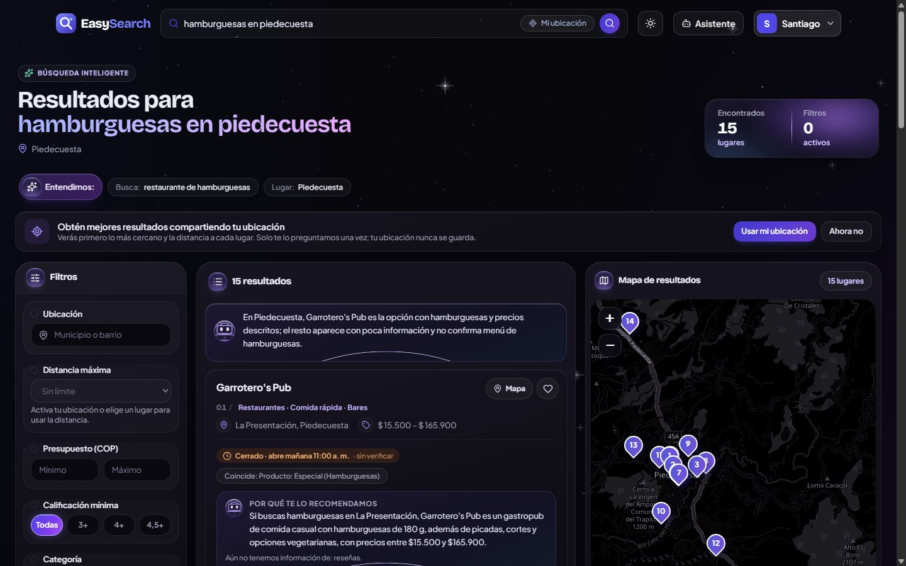<br>
      <b>Resultados.</b> Lo que entendió la IA, filtros, lista con recomendaciones y mapa.</td>
    <td width="50%">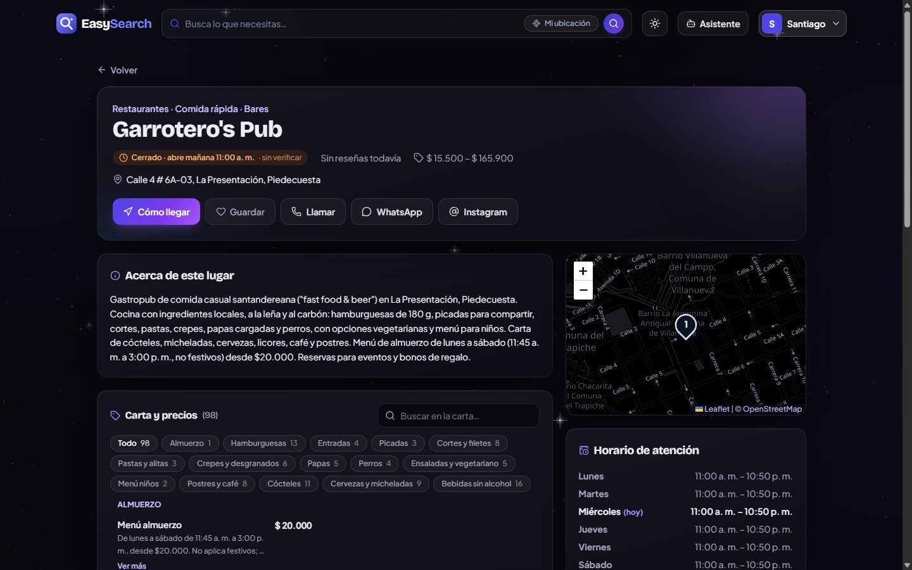<br>
      <b>Página de un negocio.</b> Datos de contacto, carta con precios, horario y mapa.</td>
  </tr>
  <tr>
    <td>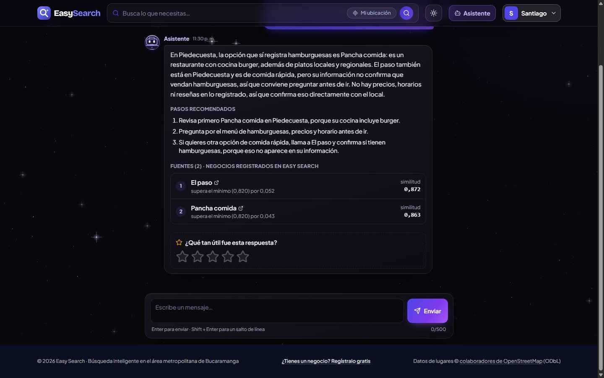<br>
      <b>Asistente con IA (RAG).</b> Responde solo con negocios registrados y muestra sus fuentes.</td>
    <td>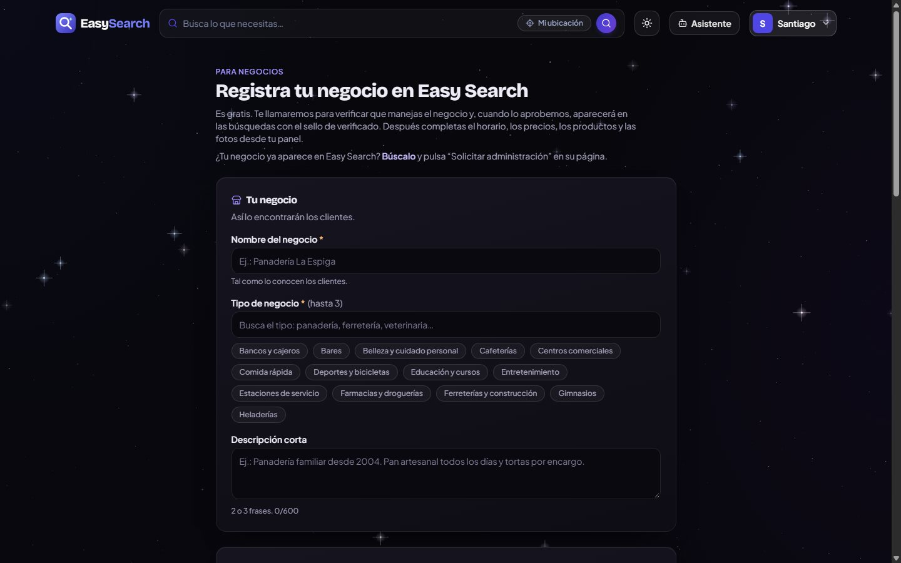<br>
      <b>Registrar un negocio.</b> El dueño envía sus datos; un administrador lo verifica.</td>
  </tr>
  <tr>
    <td>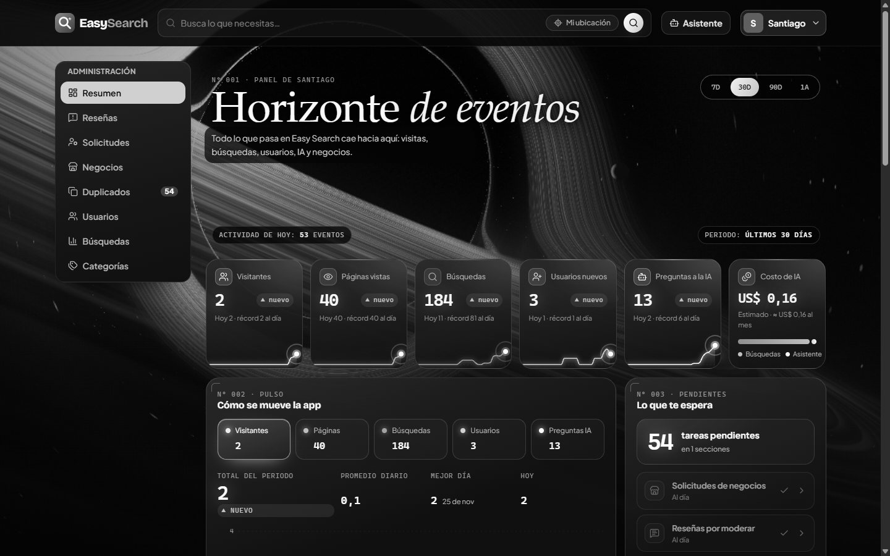<br>
      <b>Panel de administración.</b> Agujero negro en WebGL de fondo e indicadores del negocio.</td>
    <td>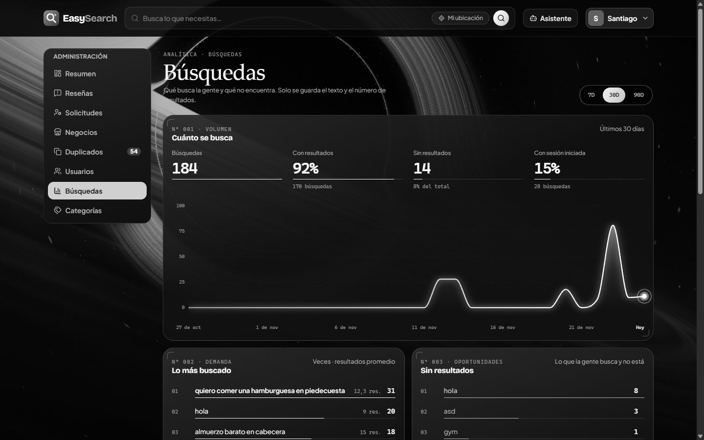<br>
      <b>Búsquedas.</b> Qué busca la gente, qué no encuentra y cuánto por día.</td>
  </tr>
</table>

---

## 🏗️ Arquitectura

El navegador **solo habla con el frontend**, y toda la API pasa por **Spring Boot**: él atiende sus rutas propias
(asistente, sistema) y reenvía el resto a **FastAPI**. Nadie llama directo a FastAPI, n8n, la base de datos ni a la IA.

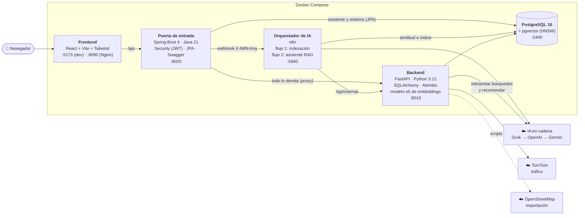

| Componente | Tecnologías | Responsabilidad |
|---|---|---|
| **Frontend** | React 19, Vite, Tailwind CSS 4, Leaflet, WebGL | Búsqueda, fichas, cuenta, asistente, panel del dueño y panel de administración |
| **Puerta de entrada** | Spring Boot 4, Spring Security, Spring Data JPA, springdoc | Única API del navegador: valida el JWT, atiende el asistente con JPA y reenvía el resto |
| **Backend** | FastAPI, SQLAlchemy, Alembic, sentence-transformers (multilingual-e5-small) | Búsqueda híbrida, cuentas, reseñas, paneles, analítica y rutas internas para n8n |
| **Orquestador** | n8n | Indexación en pgvector y flujo RAG del asistente |
| **Base de datos** | PostgreSQL 16, pgvector, unaccent, pg_trgm | Datos relacionales, vectores de 384 dimensiones e índice HNSW por similitud coseno |
| **IA** | Grok (xAI), OpenAI, Gemini | Interpretar búsquedas, recomendar y responder; en cadena, con cupo diario por usuario |

### Puertos

| Servicio | Dirección |
|---|---|
| Aplicación (desarrollo) | http://127.0.0.1:5173 |
| Aplicación (solo Docker) | http://127.0.0.1:8090 |
| Spring Boot (API) | http://127.0.0.1:8020 |
| **Swagger** (Spring Boot + FastAPI) | http://127.0.0.1:8020/swagger-ui.html |
| Estado de los servicios | http://127.0.0.1:8020/api/sistema/estado |
| FastAPI | http://127.0.0.1:8010 (documentación en `/docs`) |
| n8n | http://127.0.0.1:5690 |
| PostgreSQL | `127.0.0.1:5440` |

> Diagramas completos (seguridad del recorrido de una petición, asistente RAG e indexación):
> [docs/diagramas/arquitectura.md](docs/diagramas/arquitectura.md).

---

## ⚙️ Cómo funciona por dentro

### Una búsqueda, paso a paso

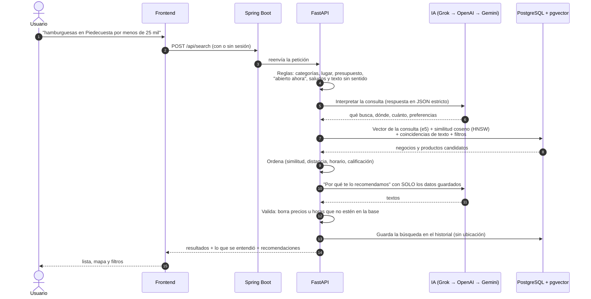

### La IA en cadena (y su costo)

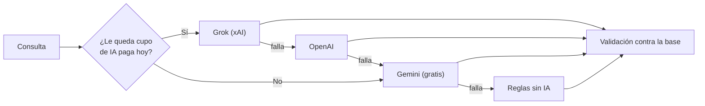

- Cada usuario tiene un **cupo diario** de IA paga (búsquedas y preguntas al asistente). Al agotarlo responde Gemini.
- Cada respuesta tiene un **tope de tokens**. El panel de administración muestra el **costo estimado** por día y al mes.

### El asistente (RAG)

1. Spring Boot guarda la pregunta (`PENDIENTE`) y llama al flujo 2 de n8n.
2. n8n convierte la pregunta en vector y busca en pgvector los 5 negocios **activos** más parecidos.
3. Si ninguno supera el **umbral de 0,82**, responde `SIN_RESULTADOS` sin gastar IA.
4. Si hay fuentes, la IA responde **solo** con sus datos; FastAPI borra lo inventado.
5. Spring Boot guarda la respuesta, sus fuentes y similitudes (`RESPONDIDA` / `SIN_RESULTADOS` / `ERROR`).

> El umbral se calibró con `scripts/calibrar_umbral.py`: acepta 29 de 30 preguntas relevantes y rechaza 18 de 20
> sin relación. Se cambia con `ASISTENTE_UMBRAL`.

### Registrar un negocio y darle su perfil

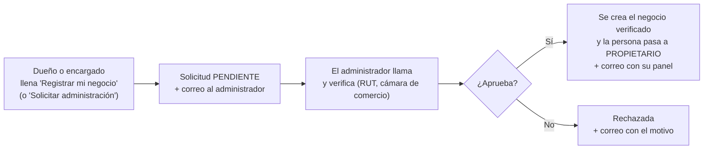

---

## 🗄️ Base de datos

**21 tablas y 34 llaves foráneas.** Una sola fuente de verdad: las **migraciones de Alembic** crean todas las tablas
(también las del asistente, que usa Spring Boot con JPA en modo `validate`).

### Diagrama general de relaciones

```mermaid
erDiagram
    USERS ||--o{ ESTABLISHMENTS : "owner_id"
    PLACES |o--o{ ESTABLISHMENTS : "municipality_id"
    PLACES |o--o{ PLACES : "parent_id"
    CATEGORIES |o--o{ CATEGORIES : "parent_id"
    ESTABLISHMENTS ||--o{ ESTABLISHMENT_CATEGORIES : "establishment_id"
    CATEGORIES ||--o{ ESTABLISHMENT_CATEGORIES : "category_id"
    ESTABLISHMENTS ||--o{ OFFERINGS : "establishment_id"
    ESTABLISHMENTS ||--o{ OPENING_HOURS : "establishment_id"
    ESTABLISHMENTS ||--o{ SPECIAL_HOURS : "establishment_id"
    ESTABLISHMENTS ||--o{ ESTABLISHMENT_PHOTOS : "establishment_id"
    ESTABLISHMENTS ||--o{ EMBEDDINGS : "establishment_id"
    ESTABLISHMENTS |o--o{ ESTABLISHMENTS : "duplicate_of_id"
    ESTABLISHMENTS ||--o{ DUPLICATE_DISMISSALS : "a / b"
    USERS ||--o{ FAVORITES : "user_id"
    ESTABLISHMENTS ||--o{ FAVORITES : "establishment_id"
    USERS ||--o{ REVIEWS : "user_id"
    ESTABLISHMENTS ||--o{ REVIEWS : "establishment_id"
    REVIEWS |o--o{ REPORTS : "review_id"
    USERS |o--o{ REPORTS : "reporter / resolved_by"
    ESTABLISHMENTS |o--o{ REPORTS : "establishment_id"
    USERS ||--o{ OWNERSHIP_CLAIMS : "user_id"
    ESTABLISHMENTS |o--o{ OWNERSHIP_CLAIMS : "establishment_id"
    USERS |o--o{ SEARCH_HISTORY : "user_id"
    ESTABLISHMENTS |o--o{ PAGE_VIEWS : "establishment_id"
    USERS ||--o{ CONSULTAS_IA : "usuario_id"
    CONSULTAS_IA ||--o{ RESPUESTAS_IA : "consulta_id"
    RESPUESTAS_IA ||--o{ FUENTES_RESPUESTA : "respuesta_id"
    ESTABLISHMENTS |o--o{ FUENTES_RESPUESTA : "establecimiento_id"
    RESPUESTAS_IA ||--o{ CALIFICACIONES : "respuesta_id"
```

### Diagramas entidad-relación (con columnas y tipos)

Generados desde la base real con `scripts/generar_diagrama_er.py`
(fuente Mermaid en [docs/diagramas/entidad-relacion.md](docs/diagramas/entidad-relacion.md)).

<details open>
<summary><b>Catálogo de negocios y búsqueda semántica</b></summary>

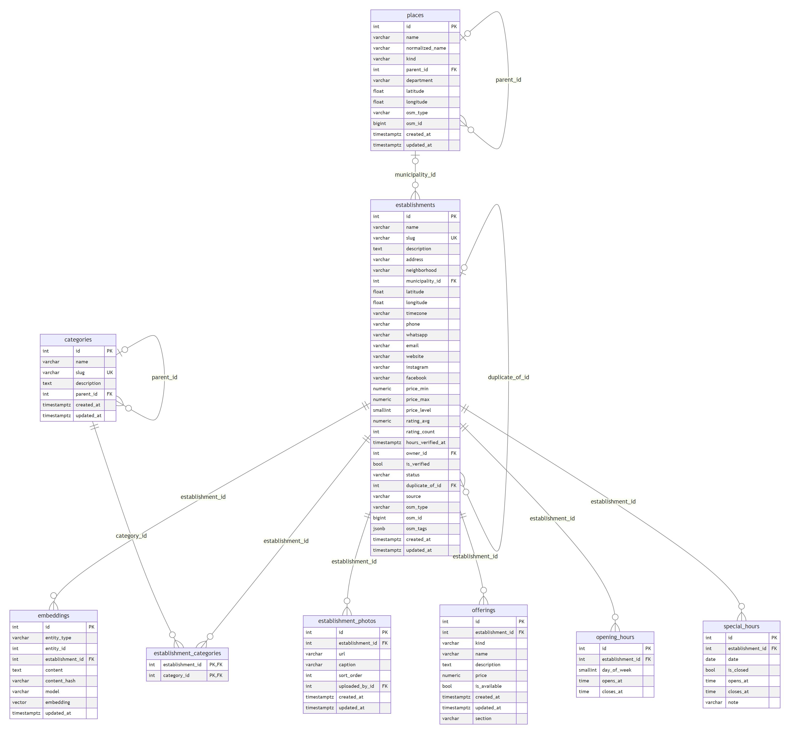
</details>

<details>
<summary><b>Usuarios e interacción</b> (cuentas, favoritos, historial, reseñas, reportes, solicitudes y visitas)</summary>

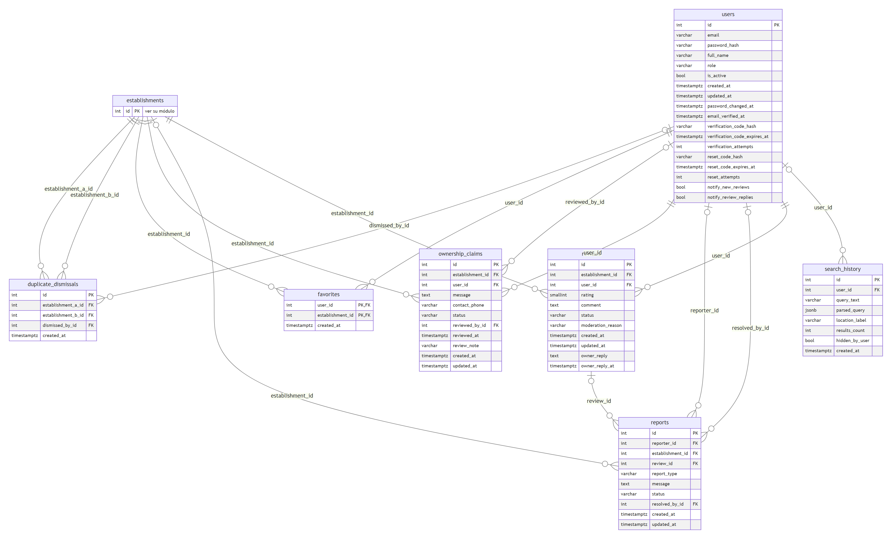
</details>

<details>
<summary><b>Asistente con IA</b> (tablas que usa Spring Boot con JPA)</summary>

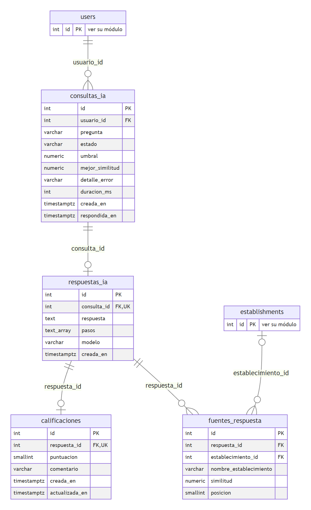
</details>

### Modelo relacional

Notación `TABLA(atributos)`: <u>**subrayado**</u> = llave primaria, *cursiva →* = llave foránea y la tabla a la que
apunta, `?` = puede quedar vacío. El modelo completo, con todos los tipos y todas las llaves foráneas, está en
[docs/diagramas/modelo-relacional.md](docs/diagramas/modelo-relacional.md)
(se regenera con `scripts/generar_modelo_relacional.py`).

<details>
<summary><b>Ver las tablas principales</b></summary>

- **USERS**(<u>**id**</u>, email `UQ`, password_hash, full_name, role, is_active, email_verified_at?, …)
- **PLACES**(<u>**id**</u>, name, normalized_name, kind, *parent_id → places*?, latitude, longitude, …)
- **CATEGORIES**(<u>**id**</u>, name, slug `UQ`, description?, *parent_id → categories*?)
- **ESTABLISHMENTS**(<u>**id**</u>, name, slug `UQ`, address?, *municipality_id → places*?, latitude, longitude,
  phone?, whatsapp?, price_min?, price_max?, rating_avg?, *owner_id → users*?, is_verified, status,
  *duplicate_of_id → establishments*?, source, …)
- **ESTABLISHMENT_CATEGORIES**(<u>***establishment_id → establishments***</u>, <u>***category_id → categories***</u>)
- **OFFERINGS**(<u>**id**</u>, *establishment_id → establishments*, kind, section?, name, description?, price?, is_available)
- **OPENING_HOURS**(<u>**id**</u>, *establishment_id → establishments*, day_of_week, opens_at, closes_at)
- **EMBEDDINGS**(<u>**id**</u>, entity_type, entity_id, *establishment_id → establishments*, embedding vector(384), content_hash)
- **REVIEWS**(<u>**id**</u>, *establishment_id → establishments*, *user_id → users*, rating, comment?, status, owner_reply?)
- **OWNERSHIP_CLAIMS**(<u>**id**</u>, kind, *establishment_id → establishments*?, *user_id → users*, contact_phone?,
  applicant_role?, proposed_data?, consent_at?, status, *reviewed_by_id → users*?, …)
- **SEARCH_HISTORY**(<u>**id**</u>, *user_id → users*?, query_text, parsed_query, location_label?, results_count, …)
- **PAGE_VIEWS**(<u>**id**</u>, created_at, section, path, *establishment_id → establishments*?, visitor_hash, device, referrer?)
- **CONSULTAS_IA**(<u>**id**</u>, *usuario_id → users*, pregunta, estado, umbral, mejor_similitud?, duracion_ms?, …)
- **RESPUESTAS_IA**(<u>**id**</u>, *consulta_id → consultas_ia*, respuesta, pasos, modelo?)
- **FUENTES_RESPUESTA**(<u>**id**</u>, *respuesta_id → respuestas_ia*, *establecimiento_id → establishments*?, similitud, posicion)
- **CALIFICACIONES**(<u>**id**</u>, *respuesta_id → respuestas_ia*, puntuacion, comentario?)

</details>

---

## 🚀 Cómo iniciarlo

Funciona en **Windows, Linux y macOS** (Intel y Apple Silicon). Hay dos formas: **¿solo quieres verlo
funcionando?** → Opción A. **¿Vas a programar?** → Opción B.

Los comandos son los mismos en los tres sistemas salvo los marcados con 🪟 **Windows** (PowerShell) y
🐧🍎 **Linux / macOS** (bash o zsh). Estas son todas las diferencias:

| Acción | 🪟 Windows (PowerShell) | 🐧🍎 Linux / macOS |
|---|---|---|
| Copiar un archivo | `Copy-Item .env.example .env` | `cp .env.example .env` |
| Python del entorno virtual | `.\.venv\Scripts\python` | `.venv/bin/python` |
| Crear el entorno virtual | `python -m venv .venv` | `python3 -m venv .venv` |
| Maven (incluido) | `.\mvnw` | `./mvnw` |
| Elegir el JDK (si hace falta) | `$env:JAVA_HOME = "C:\ruta\al\jdk"` | `export JAVA_HOME=/ruta/al/jdk` |

> **Antes de cualquiera:** Docker tiene que estar encendido. En Windows y macOS abre **Docker Desktop** y espera
> a que diga *Engine running*. En Linux, el servicio `docker` debe estar activo (`sudo systemctl start docker`).
> Si `docker` responde `failed to connect to the docker API` / `Cannot connect to the Docker daemon`, está apagado.

### Opción A · Solo con Docker (todo en contenedores)

No hace falta instalar Python, Java ni Node: un comando levanta los cinco servicios (PostgreSQL, n8n, FastAPI,
Spring Boot y el frontend con Nginx). Las imágenes funcionan igual en los tres sistemas (amd64 y arm64).

🪟 **Windows**
```powershell
Copy-Item .env.example .env          # la primera vez: complétalo (ver "Variables de entorno")
docker compose --profile completo up -d --build
```

🐧🍎 **Linux / macOS**
```bash
cp .env.example .env                 # la primera vez: complétalo (ver "Variables de entorno")
docker compose --profile completo up -d --build
```

Abre **http://127.0.0.1:8090**.

- La primera vez tarda varios minutos: se construyen las imágenes y se descarga el modelo de embeddings (~470 MB).
- Una base nueva **se crea sola** con el esquema y los datos iniciales (`docker/initdb/`).
- Crea tu administrador:
  `docker exec -it easysearch-backend python -m scripts.create_admin --email tu@correo.com --nombre "Tu Nombre"`
- Sin correo (SMTP), el código para confirmar una cuenta aparece en `docker logs easysearch-backend`.
- Apagar: `docker compose --profile completo down` (los datos quedan guardados en los volúmenes).

> Si también tienes los servidores de desarrollo encendidos, apágalos: el modo completo usa los puertos 8010 y 8020.

### Opción B · Desarrollo con 4 terminales

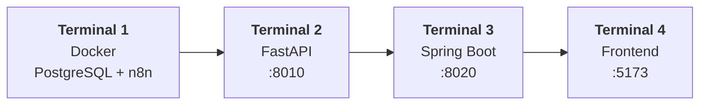

Abre 4 terminales en la carpeta del proyecto (en VS Code: botón `+` del panel de terminal). Hazlo en orden.

**Terminal 1 · Docker** (base de datos y n8n) — igual en todos
```bash
docker compose up -d
```

**Terminal 2 · Backend FastAPI**

🪟 **Windows**
```powershell
cd backend
.\.venv\Scripts\python -m uvicorn app.main:app --host 127.0.0.1 --port 8010
```

🍎 **macOS**
```bash
cd backend
.venv/bin/python -m uvicorn app.main:app --host 127.0.0.1 --port 8010
```

🐧 **Linux**
```bash
cd backend
.venv/bin/python -m uvicorn app.main:app --host 0.0.0.0 --port 8010
```

> **Por qué en Linux es `0.0.0.0`:** n8n corre dentro de Docker y llama a FastAPI en tu equipo por
> `host.docker.internal`. En Windows y macOS, Docker Desktop lo lleva al `127.0.0.1` del equipo; en Linux llega por
> la red interna de Docker, así que FastAPI debe escuchar en todas las interfaces (si no, el asistente y la
> indexación fallan). Si tu equipo está en una red pública, bloquea el puerto 8010 en el firewall.
>
> Sin `--reload` (en Windows se queda pegado): si cambias código del backend, `Ctrl + C` y vuelve a ejecutarlo.
> En Linux y macOS puedes agregar `--reload` si quieres.

**Terminal 3 · Puerta de entrada Spring Boot**

🪟 **Windows**
```powershell
cd gateway
$env:JAVA_HOME = "C:\Program Files\Eclipse Adoptium\jdk-25.0.3.9-hotspot"   # ruta de tu JDK 21+ (solo si `java -version` es menor)
.\mvnw spring-boot:run
```

🐧🍎 **Linux / macOS**
```bash
cd gateway
export JAVA_HOME=$(/usr/libexec/java_home -v 21)        # macOS, solo si `java -version` es menor que 21
export JAVA_HOME=/usr/lib/jvm/java-21-openjdk-amd64     # Linux (Debian/Ubuntu), ídem
./mvnw spring-boot:run
```
Está lista cuando muestra `Tomcat started on port 8020`.

**Terminal 4 · Frontend** — igual en todos
```bash
cd frontend
npm run dev
```

Abre **http://127.0.0.1:5173**. El panel de administración está en **http://127.0.0.1:5173/admin**.

**Para apagar:** `Ctrl + C` en las terminales 2, 3 y 4, y `docker compose stop` en la 1.

---

## 🧰 Instalación (solo la primera vez)

### Requisitos

| | 🪟 Windows | 🍎 macOS | 🐧 Linux (Debian/Ubuntu) |
|---|---|---|---|
| **Docker** | [Docker Desktop](https://www.docker.com/products/docker-desktop/) | [Docker Desktop](https://www.docker.com/products/docker-desktop/) | Docker Engine + plugin `compose` ([guía](https://docs.docker.com/engine/install/)) |
| **Python 3.12** | [python.org](https://www.python.org/downloads/) | `brew install python@3.12` | `sudo apt install python3.12 python3.12-venv` |
| **Node.js 20+** | [nodejs.org](https://nodejs.org/) | `brew install node` | [nodejs.org](https://nodejs.org/) o `nvm` |
| **JDK 21+** | [Adoptium](https://adoptium.net/) | `brew install openjdk@21` | `sudo apt install openjdk-21-jdk` |
| **Git** | [git-scm.com](https://git-scm.com/) | incluido (o `brew install git`) | `sudo apt install git` |

Maven no hace falta: el proyecto trae `mvnw`. En Linux, para usar `docker` sin `sudo`:
`sudo usermod -aG docker $USER` (y vuelve a iniciar sesión).

### Pasos

| Paso | 🪟 Windows | 🐧🍎 Linux / macOS |
|---|---|---|
| 1. Variables de entorno | `Copy-Item .env.example .env` | `cp .env.example .env` |
| | y complétalo ([ver tabla](#-variables-de-entorno)) | y complétalo |
| 2. Base de datos | `docker compose up -d` | `docker compose up -d` |
| 3. Entorno de Python (en `backend`) | `python -m venv .venv` | `python3 -m venv .venv` |
| 4. Dependencias (en `backend`) | `.\.venv\Scripts\python -m pip install -r requirements.txt` | `.venv/bin/python -m pip install -r requirements.txt` |
| 5. Tablas (en `backend`) | `.\.venv\Scripts\python -m alembic upgrade head` | `.venv/bin/python -m alembic upgrade head` |
| 6. Administrador (en `backend`) | `.\.venv\Scripts\python -m scripts.create_admin --email tu@correo.com --nombre "Tu Nombre"` | `.venv/bin/python -m scripts.create_admin --email tu@correo.com --nombre "Tu Nombre"` |
| 7. Frontend (en `frontend`) | `npm install` | `npm install` |

> **Atajo:** si activas el entorno virtual (🪟 `.\.venv\Scripts\Activate.ps1` · 🐧🍎 `source .venv/bin/activate`),
> en todos los sistemas basta con escribir `python -m …` (por ejemplo `python -m scripts.create_admin …`).

<details>
<summary><b>Datos: base inicial, OpenStreetMap y carga manual</b></summary>

**Base nueva: se crea sola.** La primera vez que Docker crea la base, PostgreSQL ejecuta `docker/initdb/`:

| Archivo | Contenido |
|---|---|
| `01-extensions.sql` | Extensiones `vector` (pgvector), `unaccent` y `pg_trgm` |
| `02-esquema.sql` | Todas las tablas, restricciones, índices (incluido el HNSW) y la versión de Alembic |
| `03-datos-iniciales.sql` | Negocios cargados a mano con sus productos y horarios, 32 categorías, municipios y barrios |

**Importar miles de negocios de OpenStreetMap** (opcional, desde `backend` con el entorno virtual activado):

```bash
python -m scripts.import_osm           # municipios, barrios y negocios reales (unos minutos)
python -m scripts.reindex_embeddings   # vectores semánticos (la 1.ª vez descarga ~470 MB)
python -m scripts.import_csv           # vuelve a cargar los negocios completados a mano
```

Para completar negocios con descripción, carta y precios: [guía de carga manual](docs/CARGA_MANUAL.md).
Preguntas para pedirle los datos a un negocio: [docs/PREGUNTAS_REGISTRO.md](docs/PREGUNTAS_REGISTRO.md).
</details>

<details>
<summary><b>n8n: flujos de IA</b></summary>

`docker compose up -d` también levanta n8n. Al arrancar, el contenedor crea sus credenciales con los valores del
`.env`, importa los flujos de `n8n/workflows/` y los publica: no hay que configurar nada a mano. Abre
http://127.0.0.1:5690 y crea la cuenta local la primera vez (solo sirve para ver los flujos).

- **Flujo 1 · indexación:** cada 30 minutos genera los vectores que faltan o cambiaron (sin duplicados). A mano:

  🪟 **Windows**
  ```powershell
  $clave = (Select-String -Path .env -Pattern '^N8N_WEBHOOK_KEY=(.+)$').Matches.Groups[1].Value
  Invoke-RestMethod -Method Post -Uri http://127.0.0.1:5690/webhook/easysearch/indexar -Headers @{ "X-N8N-Key" = $clave }
  ```

  🐧🍎 **Linux / macOS**
  ```bash
  clave=$(grep '^N8N_WEBHOOK_KEY=' .env | cut -d= -f2-)
  curl -X POST -H "X-N8N-Key: $clave" http://127.0.0.1:5690/webhook/easysearch/indexar
  ```
- **Flujo 2 · asistente RAG:** lo llama solo Spring Boot.
- Los flujos del repositorio son la fuente de verdad: si cambias uno en n8n, expórtalo a `n8n/workflows/`.
</details>

> 🪟 **Si `npm` dice "la ejecución de scripts está deshabilitada"**, ejecuta una vez
> `Set-ExecutionPolicy -Scope CurrentUser -ExecutionPolicy RemoteSigned`, o usa `npm.cmd` en lugar de `npm`.

---

## 🔐 Variables de entorno

Se copian de `.env.example` a `.env` (que **nunca** se sube a Git).

| Variable | Qué poner | ¿Obligatoria? |
|---|---|---|
| `POSTGRES_PASSWORD` y `DATABASE_URL` | La misma contraseña en las dos líneas (solo letras y números) | Sí |
| `SECRET_KEY` | Clave aleatoria de **32+ caracteres** (firma las sesiones; más corta, Spring Boot no arranca) | Sí |
| `INTERNAL_API_KEY` | Clave aleatoria (n8n → FastAPI) | Sí |
| `N8N_WEBHOOK_KEY` | Clave aleatoria (Spring Boot → n8n) | Sí |
| `N8N_ENCRYPTION_KEY` | Clave aleatoria; **no la cambies** después del primer arranque | Sí |
| `GEMINI_API_KEY` | Clave gratis de https://aistudio.google.com/apikey | Recomendada |
| `XAI_API_KEY` · `XAI_MODEL` · `XAI_BASE_URL` | Grok (de pago). Si está, responde primero | Opcional |
| `OPENAI_API_KEY` · `OPENAI_MODEL` | OpenAI (de pago), respaldo de Grok | Opcional |
| `LLM_PROVIDER` | `auto` (en cadena), `xai`, `openai` o `gemini` | Opcional |
| `OPENAI_SEARCHES_PER_DAY` · `ASISTENTE_OPENAI_POR_DIA` | Cupo diario de IA paga por usuario (búsquedas · asistente) | Opcional |
| `TOMTOM_API_KEY` · `TOMTOM_DAILY_LIMIT` | Aviso de trancón (gratis en developer.tomtom.com) | Opcional |
| `SMTP_*` | Correo para códigos y avisos; sin él, los códigos salen en la terminal del backend | Opcional |
| `TURNSTILE_SITE_KEY` · `TURNSTILE_SECRET_KEY` | Anti-robots de Cloudflare (gratis) | Opcional |
| `ASISTENTE_UMBRAL` · `ASISTENTE_CONSULTAS_POR_HORA` | Umbral de similitud (0,82) y límite de preguntas | Opcional |

Para generar una clave aleatoria (una vez por clave; en Linux/macOS usa `python3`):

```bash
python -c "import secrets; print(secrets.token_urlsafe(48))"
```

> Usa `127.0.0.1` y **no** `localhost` en las direcciones: en Windows, `localhost` prueba primero IPv6 y puede
> tardar más de 2 minutos (en Linux y macOS también funciona igual con `127.0.0.1`).

---

## 👥 Roles y panel de administración

| Rol | Qué puede hacer |
|---|---|
| **Visitante** | Ver negocios y probar unas pocas búsquedas |
| **Usuario** (correo confirmado) | Buscar, usar el asistente, reseñar, guardar favoritos, ver su historial y registrar su negocio |
| **Propietario** | Todo lo anterior + editar su negocio (datos, horario, carta, precios y fotos) y responder reseñas |
| **Administrador** | Todo + el panel de administración |

**Panel de administración** (`/admin`), siempre en modo oscuro (negro y grises), con un agujero negro en WebGL de fondo
(se convierte en protector de pantalla tras 2 minutos sin actividad):

| Sección | Para qué |
|---|---|
| **Resumen** | Visitantes, búsquedas, usuarios, IA y costo estimado, horas pico, tráfico, crecimiento, demanda y negocios |
| **Reseñas** | Moderar reseñas y reportes |
| **Solicitudes** | Verificar a quien pide un negocio o registra uno nuevo, y aprobar o rechazar (con correo) |
| **Negocios · Duplicados** | Editar, ocultar, quitar dueño y unir negocios repetidos |
| **Usuarios** | Cambiar roles y desactivar cuentas |
| **Búsquedas · Categorías** | Qué busca la gente, qué no encuentra y cómo está repartido el catálogo |

---

## 🛡️ Seguridad y privacidad

- **Sesión:** FastAPI emite un JWT (HS256) y Spring Boot lo valida con la misma clave; las contraseñas usan Argon2.
- **Rutas internas:** `/api/internal/*` solo acepta la clave de n8n; desde afuera Spring Boot responde 404.
- **IP real:** cada servicio solo acepta `X-Forwarded-For` del servicio anterior, así nadie se salta los límites.
- **Ubicación:** viaja solo en la búsqueda y **nunca se guarda** (ni en el historial ni se envía a la IA).
- **Visitas (analítica propia):** anónimas, **sin cookies** ni servicios externos. No se guarda la IP: solo un
  código del visitante que cambia cada día. No se cuentan robots, el panel de administración ni a quien activó
  "No rastrear".
- **Solicitudes de negocios:** piden autorización expresa para el tratamiento de datos (Ley 1581 de 2012).
- **IA:** nunca inventa datos verificables; precios, horas y calificaciones que no estén en la base se eliminan.
- **Secretos:** todo en `.env`; las credenciales de n8n se crean al arrancar y no quedan en los flujos exportados.

---

## 🧪 Pruebas

| Qué | Comando | Notas |
|---|---|---|
| **Backend** (FastAPI) | `cd backend` → `python -m pytest` | Usa la base aparte `easysearch_test` (se crea sola) |
| **Puerta de entrada** (Spring Boot) | `cd gateway` → `.\mvnw test` (🪟) · `./mvnw test` (🐧🍎) | Perfil `test` (sin base) y `it` (base de pruebas real; corre antes `pytest`) |
| **Frontend** | `cd frontend` → `npm run lint` · `npm run build` | ESLint y compilación |
| **API completa** (Postman) | `npx -y -p newman newman run docs/postman/EasySearch.postman_collection.json -e …` | 42 peticiones · 118 comprobaciones ([ver sección](#-api-swagger-y-postman)) |
| **Calidad de la búsqueda** | `python -m scripts.benchmark_search` | Precisión@5, municipio correcto y tiempos (`--con-ia` usa la IA) |
| **Una búsqueda desde la terminal** | `python -m scripts.eval_search "pizza en Cabecera"` | No guarda historial |
| **Dependencias** | `npm audit` · `pip_audit -r requirements.txt` | Vulnerabilidades conocidas |

> Los comandos `python -m …` se ejecutan desde `backend` con el entorno virtual activado (🪟 `.\.venv\Scripts\Activate.ps1` · 🐧🍎 `source .venv/bin/activate`).

---

## 🧩 API: Swagger y Postman

### Swagger (documentación interactiva)

**http://127.0.0.1:8020/swagger-ui.html**. Arriba a la derecha se elige la API: **FastAPI** (71 operaciones en
10 secciones: búsqueda, cuentas, catálogo, reseñas, negocios, administración…) o **Spring Boot** (asistente y
sistema). Todas tienen título en español; con **Authorize** se pega el token para probar las rutas protegidas.
Las especificaciones exportadas están en [docs/api/](docs/api/) (`openapi-fastapi.json` y `openapi-spring.json`).

<table>
  <tr>
    <td width="50%">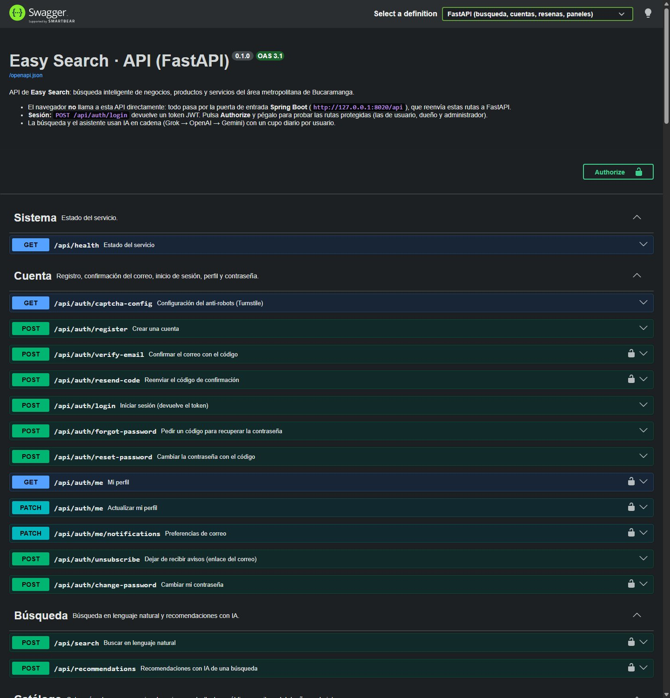<br><b>FastAPI</b> en Swagger: secciones y títulos en español.</td>
    <td width="50%">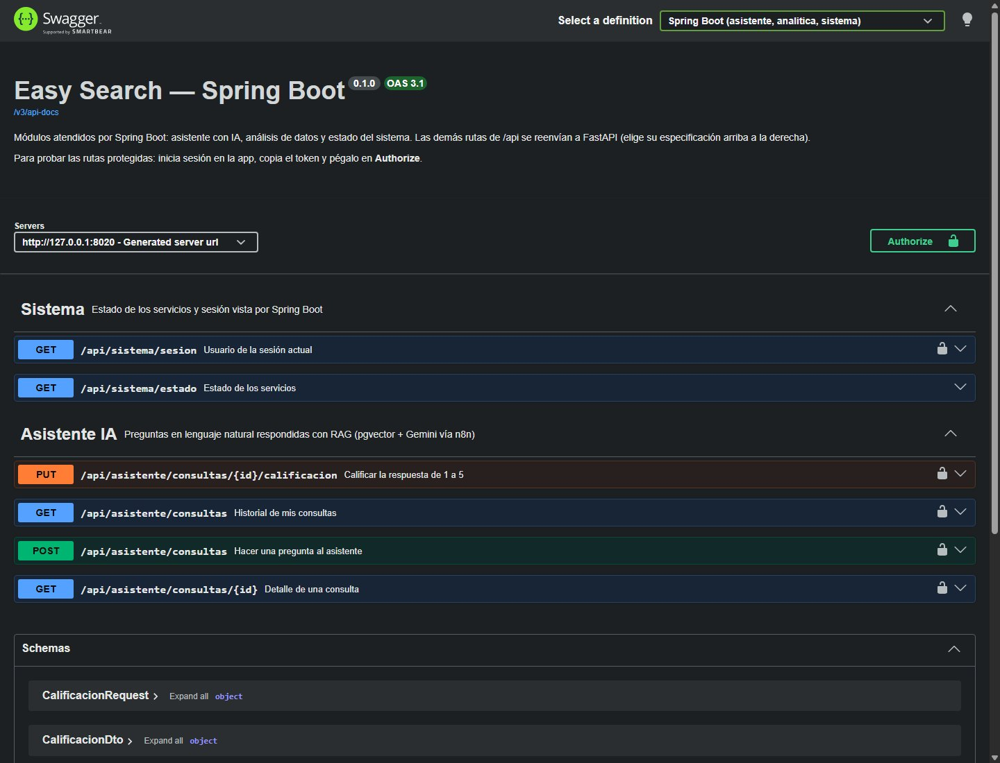<br><b>Spring Boot</b> en Swagger: asistente y sistema.</td>
  </tr>
  <tr>
    <td>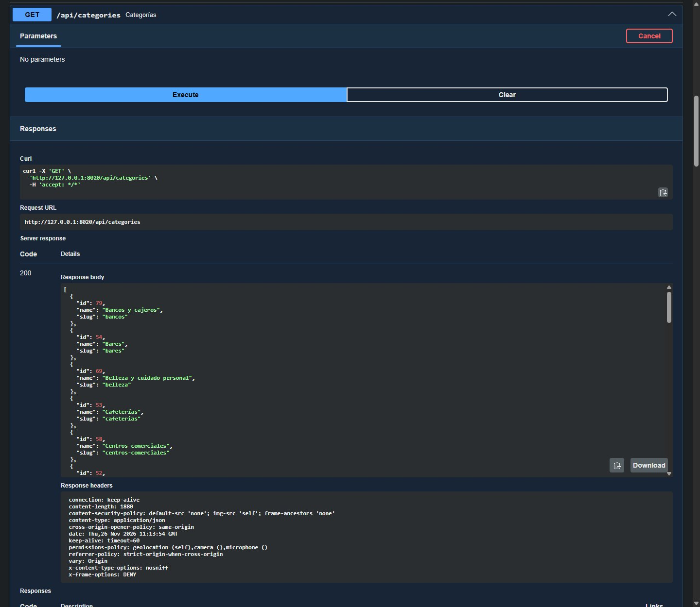<br>Petición ejecutada desde Swagger (<code>GET /api/categories</code> → 200).</td>
    <td>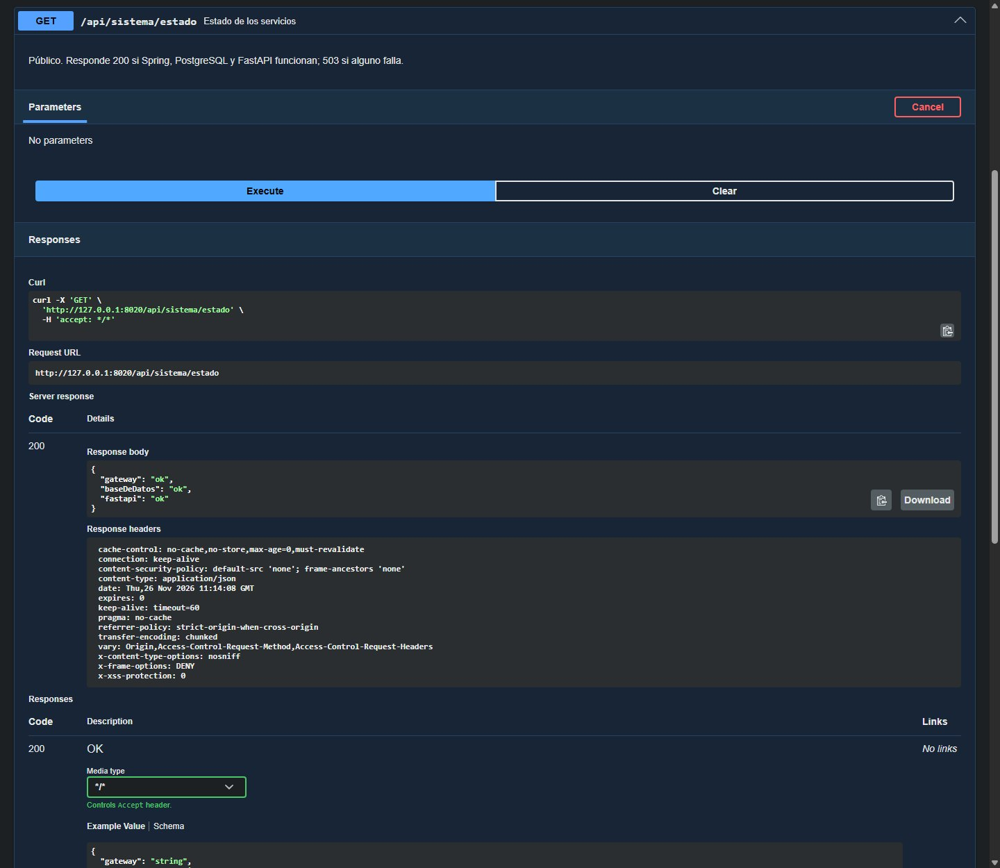<br>Petición ejecutada desde Swagger (<code>GET /api/sistema/estado</code> → 200).</td>
  </tr>
</table>

### Postman (colección de pruebas)

En [docs/postman/](docs/postman/):

| Archivo | Qué es |
|---|---|
| `EasySearch.postman_collection.json` | **42 peticiones en 11 carpetas** con **118 comprobaciones**: sistema, cuenta, catálogo, búsqueda, favoritos e historial, reseñas, asistente, solicitudes, tráfico, analítica y administración |
| `EasySearch.local.postman_environment.json` | Entorno `Easy Search · local` (`base_url`, credenciales y token) |
| `reporte-pruebas.html` | Reporte de la última ejecución: **42/42 peticiones y 118/118 comprobaciones correctas** |
| `reporte-pruebas.junit.xml` | El mismo resultado en formato JUnit |

Las pruebas no solo miran el código de respuesta: también comprueban, por ejemplo, que un saludo no devuelva
negocios, que el asistente cite fuentes por encima del umbral, que un usuario normal reciba 403 en el panel y que los
datos inválidos den 422. El token se guarda solo al iniciar sesión y lo usan las demás peticiones.

**Usarla en Postman:** *Import* → los dos archivos → elegir el entorno *Easy Search · local* → llenar
`user_email`/`user_password` (y `admin_*`) → *Run collection*.

> Con el anti-robots (Turnstile) activo, el login sin captcha responde 400 (la colección lo comprueba). Para
> probar con sesión, pega en `token` el token de tu sesión, o usa las claves de prueba de Cloudflare que trae
> `.env.example`.

**Correrla por consola con Newman** (no hay que instalar nada):

```bash
cd docs/postman
npx -y -p newman -p newman-reporter-htmlextra newman run EasySearch.postman_collection.json -e EasySearch.local.postman_environment.json -r cli,htmlextra --reporter-htmlextra-export reporte-pruebas.html
```

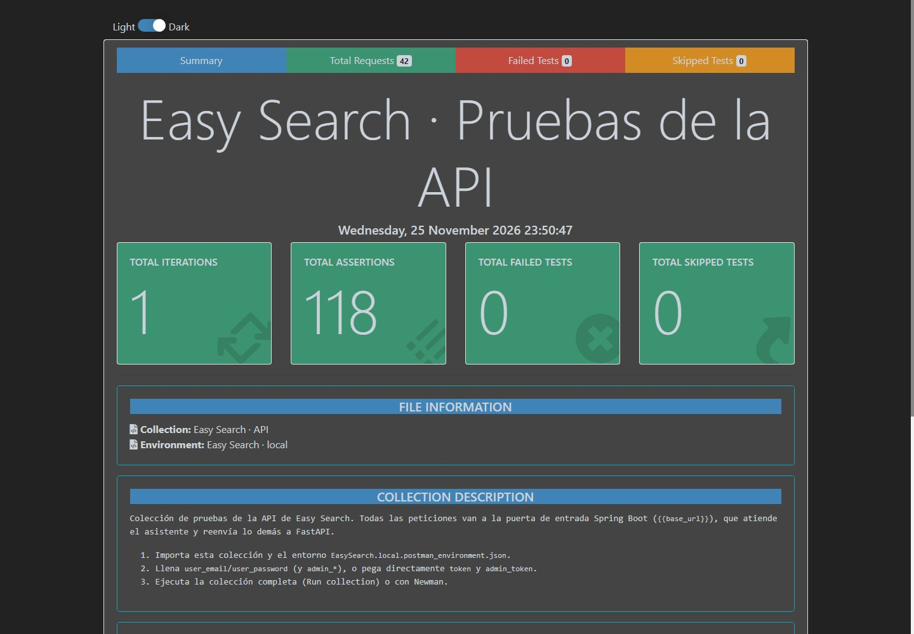

---

## 🛠️ Comandos útiles

```bash
# (desde backend, con el entorno virtual activado; iguales en Windows, Linux y macOS)
python -m alembic revision --autogenerate -m "descripcion"   # nueva migración
python -m alembic upgrade head                               # aplicar migraciones
python -m scripts.generar_diagrama_er                        # diagramas entidad-relación
python -m scripts.generar_modelo_relacional                  # modelo relacional
python -m scripts.exportar_sql_inicial                       # scripts SQL de docker/initdb
docker exec -it easysearch-db psql -U easysearch -d easysearch   # consola SQL
```

---

## 🩺 Solución de problemas

| Síntoma | Causa y solución |
|---|---|
| `failed to connect to the docker API` / `Cannot connect to the Docker daemon` | Docker está apagado: abre Docker Desktop (Windows/macOS) y espera *Engine running*, o `sudo systemctl start docker` (Linux) |
| 🐧 `permission denied … docker.sock` | Tu usuario no está en el grupo `docker`: `sudo usermod -aG docker $USER` y vuelve a iniciar sesión |
| La base tarda minutos en conectar | Estás usando `localhost`: cámbialo por `127.0.0.1` |
| 🪟 El backend se queda pegado al cambiar código | No uses `--reload` en Windows; reinicia con `Ctrl + C` |
| `mvnw` dice que Java es muy viejo | Define `JAVA_HOME` con un JDK 21+ antes de `mvnw spring-boot:run` |
| 🐧🍎 `./mvnw: Permission denied` | El archivo perdió el permiso de ejecución: `chmod +x gateway/mvnw` |
| 🐧🍎 `/bin/sh^M: bad interpreter` | El archivo se guardó con saltos de línea de Windows: `sed -i 's/\r$//' gateway/mvnw` (en macOS: `sed -i '' 's/\r$//' gateway/mvnw`). Con el `.gitattributes` del proyecto no vuelve a pasar |
| 🐧 El asistente o la indexación fallan (n8n no llega al backend) | En Linux, FastAPI debe escuchar con `--host 0.0.0.0` (ver terminal 2) |
| `ERR_CONNECTION_REFUSED` en el navegador | La terminal 4 (`npm run dev`) no está corriendo |
| "Puerto en uso" (8010, 8020 o 5173) | Quedó un servidor abierto: ciérralo, o apaga el modo completo de Docker |
| No aparece el "Panel administrativo" | Crea el administrador con `scripts.create_admin` y vuelve a iniciar sesión |
| El asistente responde `ERROR` | Falta `GEMINI_API_KEY` (u otra clave de IA) en el `.env` |

---

## 📁 Estructura del proyecto

```
├── docker-compose.yml     PostgreSQL + pgvector y n8n; con --profile completo, todo el sistema
├── docker/initdb/         SQL de la base inicial: extensiones, esquema y datos reales
├── .env.example           plantilla de variables de entorno
├── docs/                  propuesta, avance, diagramas, imágenes del programa y evidencias
├── gateway/               puerta de entrada Spring Boot (Java)
│   └── src/main/java/com/easysearch/gateway/
│       ├── config/        propiedades, CORS, rutas propias y Swagger
│       ├── asistente/     asistente IA: entidades JPA, servicio, cliente de n8n y endpoints
│       ├── seguridad/     validación del JWT, permisos y errores 401/403
│       ├── usuario/       entidad Usuario (solo lectura)
│       ├── sistema/       estado de los servicios y sesión actual
│       └── proxy/         reenvío de peticiones a FastAPI
├── n8n/                   flujos exportados (JSON), arranque y credenciales
├── backend/               FastAPI
│   ├── app/
│   │   ├── api/routes/    endpoints (búsqueda, cuentas, catálogo, reseñas, dueño, admin, analítica, tráfico…)
│   │   ├── services/      búsqueda, IA (llm/), recomendaciones, embeddings, correos, dashboard…
│   │   ├── models/        tablas (SQLAlchemy)
│   │   ├── schemas/       validación (Pydantic)
│   │   └── core/ · db/    configuración, seguridad (Argon2, JWT) y conexión
│   ├── alembic/           migraciones
│   ├── scripts/           importación OSM, administrador, diagramas, SQL inicial, evaluación
│   └── tests/
└── frontend/              React + Vite
    └── src/
        ├── pages/         inicio, resultados, lugar, asistente, perfil, panel del dueño y admin/
        ├── components/    mapa, tarjetas, agujero negro (admin/blackhole) y piezas compartidas
        └── lib/ · context/ API, formato, analítica, sesión y tema
```

---

## 📚 Documentación y créditos

| Documento | Contenido |
|---|---|
| [docs/Propuesta_Easy_Search.pdf](docs/Propuesta_Easy_Search.pdf) | Propuesta técnica y plan de trabajo |
| [docs/AVANCE.md](docs/AVANCE.md) | Registro de avance por fases |
| [docs/diagramas/](docs/diagramas/) | Arquitectura, entidad-relación, modelo relacional e imágenes |
| [docs/api/](docs/api/) · [docs/postman/](docs/postman/) | Especificaciones OpenAPI, colección de Postman y reporte de pruebas |
| [AI_USAGE.md](AI_USAGE.md) | Uso de inteligencia artificial en el desarrollo |

Los datos de establecimientos provienen en parte de © colaboradores de
[OpenStreetMap](https://www.openstreetmap.org/copyright), disponibles bajo licencia ODbL.
