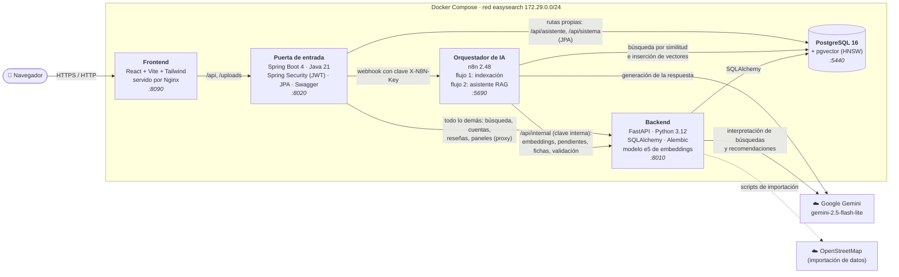
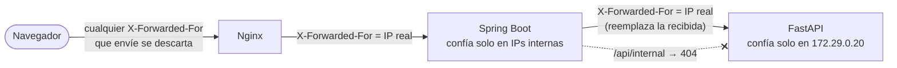
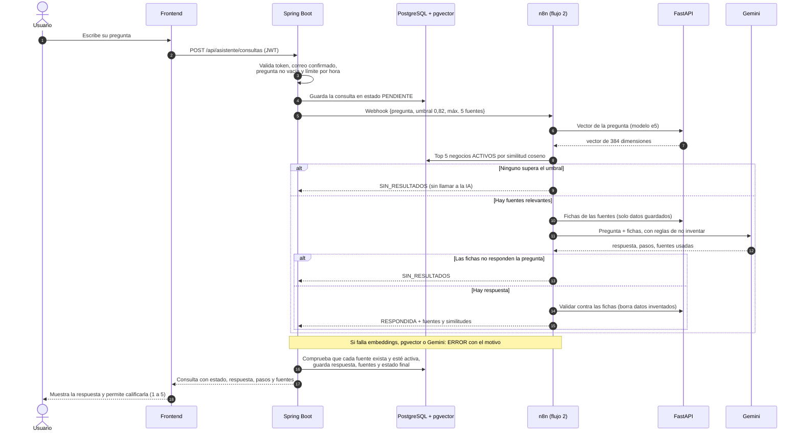
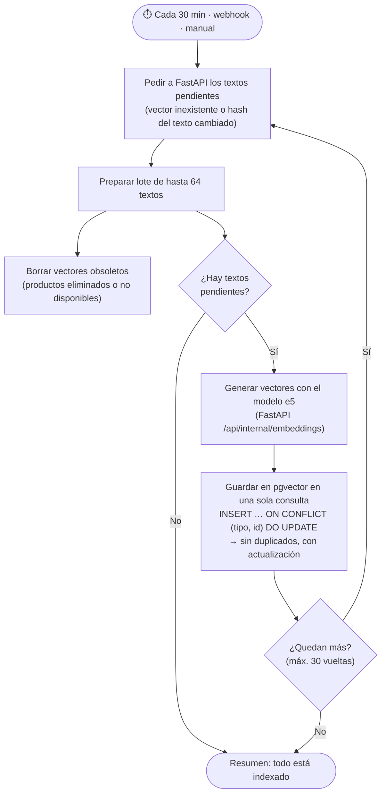

# Diagramas de arquitectura

## 1. Componentes

Cinco servicios en Docker Compose (`docker compose --profile completo up -d`). El navegador solo habla con el
frontend; toda la API pasa por Spring Boot, que decide si atiende la petición o la reenvía a FastAPI. Ni el
navegador ni el frontend llaman directamente a FastAPI, n8n, pgvector o Gemini.

| Componente | Tecnologías | Responsabilidad |
|---|---|---|
| Frontend | React 19, Vite, Tailwind CSS, Leaflet, Nginx | Interfaz: búsqueda, fichas, cuenta, paneles y asistente |
| Puerta de entrada | Spring Boot 4, Spring Security, Spring Data JPA (Hibernate), springdoc (Swagger) | Única API del navegador. Valida el JWT, atiende el asistente con JPA, reenvía el resto a FastAPI y llama a n8n |
| Backend | FastAPI, SQLAlchemy, Alembic, sentence-transformers (multilingual-e5-small) | Búsqueda híbrida, cuentas, reseñas, paneles, migraciones y rutas internas para n8n |
| Orquestador | n8n | Flujo de indexación en pgvector y flujo RAG del asistente |
| Base de datos | PostgreSQL 16, pgvector, unaccent, pg_trgm | Datos relacionales, vectores de 384 dimensiones e índice HNSW por similitud coseno |
| Modelo de lenguaje | Google Gemini | Respuestas del asistente y recomendaciones, siempre a partir de datos de la base |

## 2. Seguridad en el recorrido de una petición

- **Sesión:** FastAPI emite un JWT (HS256) al iniciar sesión. Spring Boot valida ese mismo token con la misma
  clave, y las mismas reglas: cuenta activa y token posterior al último cambio de contraseña.
- **Rutas internas:** `/api/internal/*` de FastAPI solo aceptan la clave `INTERNAL_API_KEY` (n8n), y Spring
  Boot responde 404 si alguien las pide desde afuera.
- **Webhooks de n8n:** exigen la cabecera `X-N8N-Key`, que solo conoce Spring Boot.
- **Secretos:** todas las claves vienen del `.env`. Las credenciales de n8n se crean al arrancar el contenedor y
  no quedan en los flujos exportados.

## 3. Asistente RAG: recorrido de una pregunta

## 4. Indexación de la base de conocimiento (flujo 1 de n8n)

Se ejecuta cada 30 minutos, a pedido (webhook) o a mano desde n8n.

