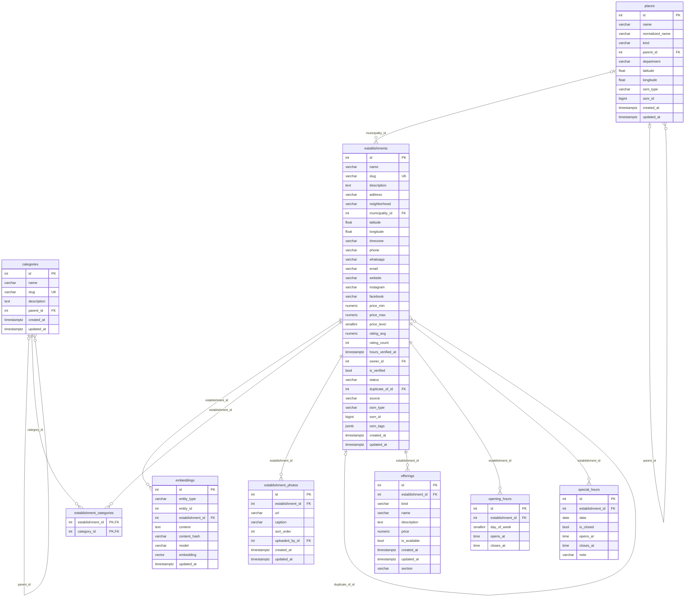
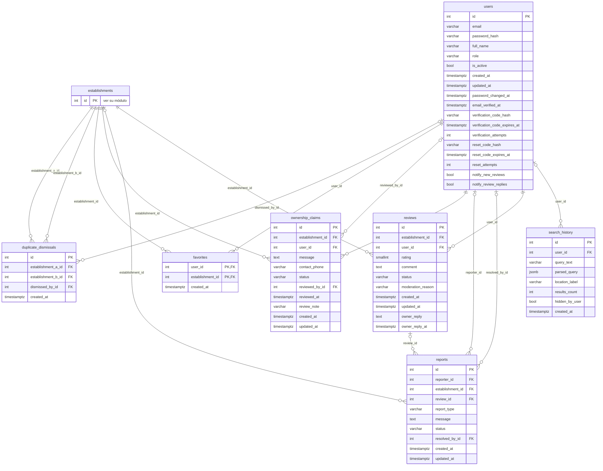
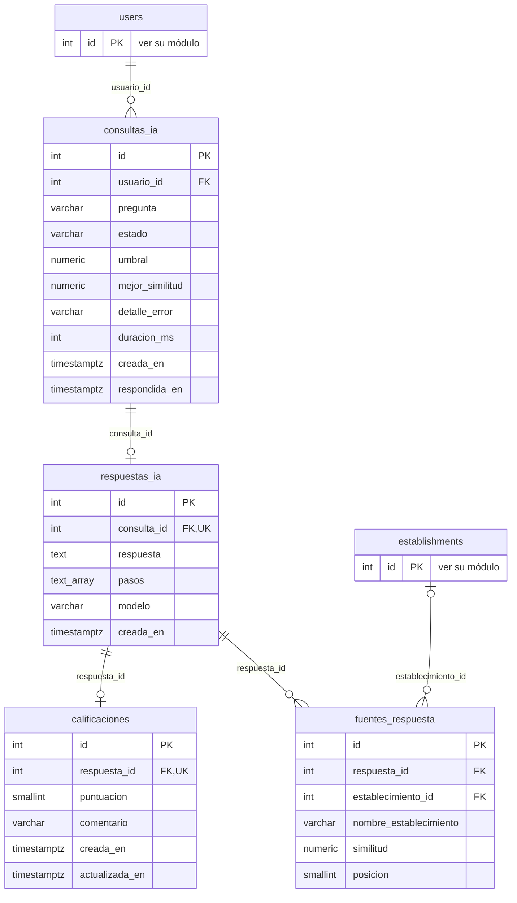

# Diagramas entidad-relación

Generado desde la base de datos real con `backend/scripts/generar_diagrama_er.py` el 2026-11-20.
Base de datos: PostgreSQL 16 + pgvector. Esquema administrado con migraciones de Alembic.

Convenciones: **PK** llave primaria, **FK** llave foránea, **UK** valor único. `||--o{` uno a muchos, `||--o|` uno a uno, `|o` el padre es opcional (la columna admite nulo).

Total: 20 tablas y 33 relaciones.

## Catálogo de negocios y búsqueda semántica

Negocios, sus productos y servicios, horarios, fotos, categorías, lugares y los vectores de pgvector.

## Usuarios e interacción

Cuentas, favoritos, historial de búsqueda, reseñas, reportes, solicitudes de propiedad y duplicados.

## Asistente con IA (Spring Boot + JPA)

Consultas al asistente RAG, respuestas, fuentes con su similitud y calificaciones. Las tablas las crea Alembic y Spring Boot las usa con JPA (`gateway/.../asistente`).

## Restricciones e índices principales

- **Integridad:** llaves foráneas con `ON DELETE CASCADE` (lo que depende de un usuario o negocio se borra con él) o `SET NULL` (se conserva el historial, por ejemplo las fuentes de una respuesta).
- **Reglas de negocio en la base (`CHECK`):** roles y estados válidos, calificaciones de 1 a 5, pregunta no vacía, umbral entre 0 y 1, similitudes entre -1 y 1.
- **Unicidad:** un correo por usuario, una reseña por usuario y negocio, un vector por elemento, una respuesta por consulta, una calificación por respuesta.
- **Índices:** HNSW de pgvector sobre `embeddings.embedding` (similitud coseno), índices de búsqueda de texto y por llaves foráneas, e historial del asistente por usuario y fecha.
